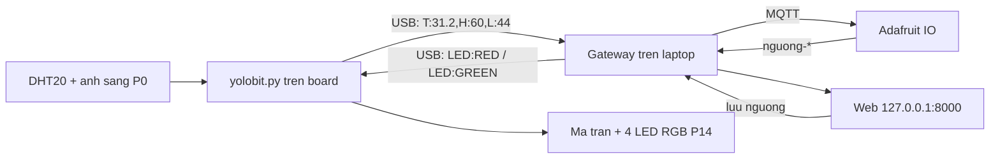

# YOLOHome — Hướng dẫn chạy cho cả nhóm

Đồ án đa ngành hướng trí tuệ nhân tạo, HK261, Nhóm 1, lớp L01. Mô hình một phòng nhà thông minh trên kit OhStem **Yolo:Bit**.

Laptop đóng vai **IoT Gateway**: đọc cảm biến qua cáp USB, đẩy số liệu lên Adafruit IO, so ngưỡng, gửi lệnh đèn xuống board, và chạy web điều khiển. AI không chạy trên Yolo:Bit.

Tài liệu liên quan: đặc tả [User_Requirements.md](User_Requirements.md) · báo cáo nháp [Bao_cao_NhaThongMinh.md](Bao_cao_NhaThongMinh.md) · checklist dạng tick [code/HUONG_DAN.md](code/HUONG_DAN.md) · giao thức [docs/PROTOCOL.md](docs/PROTOCOL.md) · tiến độ [docs/ROADMAP.md](docs/ROADMAP.md).

---

## Mục lục

1. [Chọn cách chạy](#1-chọn-cách-chạy)
2. [Cài đặt một lần](#2-cài-đặt-một-lần)
3. [Feed trên Adafruit IO](#3-feed-trên-adafruit-io)
4. [Nạp code lên Yolo:Bit](#4-nạp-code-lên-yolobit)
5. [Chạy web cùng board (cách demo chính)](#5-chạy-web-cùng-board-cách-demo-chính)
6. [Chạy web không cần board (giả lập)](#6-chạy-web-không-cần-board-giả-lập)
7. [Các cách chạy khác](#7-các-cách-chạy-khác)
8. [Dùng web](#8-dùng-web)
9. [Lỗi thường gặp](#9-lỗi-thường-gặp)
10. [Phần cứng, giao thức, thư mục](#10-phần-cứng-giao-thức-thư-mục)
11. [Đã làm và chưa làm](#11-đã-làm-và-chưa-làm)

---

## 1. Chọn cách chạy

| Bạn muốn | Cần board? | Làm theo |
| --- | --- | --- |
| **Demo đầy đủ**: board đọc cảm biến, web hiện số, cảnh báo đổi đèn | Có | Mục 2 → 3 → 4 → 5 |
| Xem và thử giao diện web, không có board trong tay | Không | Mục 2 → 6 |
| Chạy gateway không có web (như trước đây) | Có | Mục 2 → 3 → 4 → 7 |

Mọi lệnh bên dưới chạy trong **PowerShell** trên Windows, trong thư mục `code`.

---

## 2. Cài đặt một lần

Cần **Python 3** (khuyên dùng 3.11 trở lên) và Internet.

```powershell
cd code
py -3 -m venv .venv
.\.venv\Scripts\python.exe -m pip install -r requirements.txt
copy .env.example .env
```

> Luôn chạy bằng `.\.venv\Scripts\python.exe`, không gõ `python` trần. Trên một số máy, `python` là bản của MSYS2 và không có pip.

Mở file `code\.env` bằng Notepad/VS Code và điền:

| Dòng | Điền gì |
| --- | --- |
| `AIO_USERNAME` | Username Adafruit IO của nhóm |
| `AIO_KEY` | **Active Key** (biểu tượng chìa khóa vàng trên [io.adafruit.com](https://io.adafruit.com)), không phải mật khẩu đăng nhập |
| `COM_PORT` | Để tạm. Điền ở mục 4, khi OhStem hiện tên cổng (thường `COM11`, `COM12`; mỗi máy một khác) |
| `WEB_PASSWORD` | Mật khẩu **riêng** để đăng nhập web. Không dùng lại `AIO_KEY` |
| `WEB_DATA` | `mock`, `gateway` hoặc `live` (xem mục 5–7) |

Các dòng còn lại (tên feed, ngưỡng mặc định, `WEB_PORT`...) để nguyên như `.env.example`.

> **Bảo mật:** `.env` đã nằm trong `.gitignore`. Không commit, không gửi key lên nhóm chat, không chụp màn hình có key. Xin username/key từ trưởng nhóm qua tin nhắn riêng.

Thư viện cài từ `code/requirements.txt`: `paho-mqtt`, `pyserial`, `python-dotenv`. Web không cần cài thêm gì (không Node, không npm).

---

## 3. Feed trên Adafruit IO

Chỉ cần làm một lần cho tài khoản của nhóm. Tên phải đúng cột **Key**, không phải tên hiển thị.

| Key | Ý nghĩa | Bắt buộc? |
| --- | --- | --- |
| `nhiet-do` | Nhiệt độ, °C | Có |
| `do-am` | Độ ẩm không khí, % | Có |
| `anh-sang` | Ánh sáng, thang 0–100 | Có |
| `canh-bao` | Câu cảnh báo (`Bình thường` hoặc nội dung vượt ngưỡng) | Có |
| `nguong-nhiet` | Cảnh báo khi nhiệt độ **>** số này (0–80) | Nên có. Không có thì dùng `TEMP_MAX` trong `.env` (32) |
| `nguong-am` | Cảnh báo khi độ ẩm **>** số này (0–100) | Không bắt buộc. Không có thì dùng `HUMID_MAX` (80) |
| `nguong-sang` | Cảnh báo khi ánh sáng **<** số này (0–100) | Không bắt buộc. Không có thì dùng `LIGHT_MIN` (20) |

- Gateway tự tạo feed còn thiếu lúc khởi động. Nếu tài khoản đã đủ **10 feed** (giới hạn bản miễn phí), nó in `Tai khoan da du 10 feed` và bỏ qua.
- Muốn có chỗ cho feed mới: xóa các feed cũ không dùng `temperature`, `humidity`, `light`.
- Bản miễn phí chỉ cho khoảng **30 điểm dữ liệu mỗi phút**. Chương trình đã tự giới hạn; đừng tự thêm vòng gửi dữ liệu.
- Dashboard Adafruit (Module 5) dựng theo danh sách khối trong [docs/ADAFRUIT_DASHBOARD.md](docs/ADAFRUIT_DASHBOARD.md).

---

## 4. Nạp code lên Yolo:Bit

1. Cắm Yolo:Bit vào mạch mở rộng. **DHT20** vào một cổng **I2C**, **cảm biến ánh sáng** vào **P0**, **4 LED RGB** vào **P14**. Cáp USB vào laptop.
2. Mở [app.ohstem.vn](https://app.ohstem.vn) bằng Chrome hoặc Edge, chọn **Yolo:Bit**, bấm kết nối **USB**.
3. Ghi lại tên cổng COM hiện ra. Không thấy cổng thì cài driver tại [ohstem.vn/driver](https://ohstem.vn/driver) rồi cắm lại.
4. Sửa `COM_PORT` trong `code\.env` cho trùng cổng đó, lưu file.
5. Trên OhStem chuyển sang chế độ **Python**. Xóa code mẫu. Mở `code/yolobit.py`, chọn hết, dán vào ô soạn thảo, bấm **Chạy**.
6. Mở cửa sổ serial. Khoảng mỗi 2 giây phải có một dòng như `T:31.2,H:60,L:44` (thiếu độ ẩm, ví dụ `T:31.2,L:44`, vẫn được).
7. Báo thiếu `aiot_dht20` / `aiot_rgbled`: vào thư viện, tải **AIOT KIT**, bấm **Chạy** lại.
8. Thấy dòng `T:...` thì bấm **Lưu project vào thiết bị**.
9. Bấm **ngắt kết nối** trong OhStem. Giữ nguyên dây USB. Cổng vẫn bị chiếm thì đóng hẳn tab OhStem.

Đúng khi ma trận 5x5 sáng một điểm ở giữa và 4 LED RGB sáng xanh lá.

> - **Không** chạy `python yolobit.py` trên laptop. File đó là MicroPython, chỉ chạy trên board.
> - **Không** nạp `code/board_main_backup.py` (bản thử cũ, cảm biến cắm khác chân).
> - OhStem và chương trình trên laptop **không được giữ cùng một cổng COM**. OhStem chỉ dùng để nạp code.

---

## 5. Chạy web cùng board (cách demo chính)

Một lệnh duy nhất: web chạy luôn Module 1 + 2 (đọc board, gửi Adafruit, so ngưỡng, đổi đèn) và hiện số lên trình duyệt.

1. Làm xong mục 4, OhStem đã ngắt kết nối.
2. Trong `code\.env`: `WEB_DATA=gateway`, có `WEB_PASSWORD`, `COM_PORT` đúng.
3. Chạy:

   ```powershell
   .\.venv\Scripts\python.exe web_server.py
   ```

4. Mở trình duyệt **trên chính laptop đó**: `http://127.0.0.1:8000`, đăng nhập bằng `WEB_PASSWORD`.

Cửa sổ PowerShell in lần lượt các dòng kiểu:

```text
Web - Module 5
Du lieu: chay luon Module 1 + 2 tren cong COM12
Gateway: module 1 + module 2
Dang doc COM12 toc do 115200
Da ket noi Adafruit
Nhan: T:31.2,H:60,L:44
Doc: T=31.2 H=60 L=44
Gui: nhiet-do=31.2, do-am=60, anh-sang=44
Canh bao: Bình thường
Lenh den: GREEN
Mo trinh duyet: http://127.0.0.1:8000
```

**Kiểm tra demo:**

- [ ] Thẻ nhiệt độ, độ ẩm, ánh sáng trên web đổi theo board trong vòng 5 giây.
- [ ] Trên Adafruit, `nhiet-do`, `do-am`, `anh-sang` có điểm mới.
- [ ] Hơ tay vào DHT20 cho vượt ngưỡng: web hiện thẻ đỏ "VƯỢT NGƯỠNG!", dòng LED chuyển đỏ, có thông báo góc phải; ma trận sáng hết, 4 LED RGB nháy đỏ; feed `canh-bao` có chữ `Nhiệt độ cao`.
- [ ] Bỏ tay ra, đợi nhiệt xuống: tất cả về xanh, `canh-bao` về `Bình thường`.
- [ ] Che cảm biến ánh sáng xuống dưới 20: cảnh báo thêm `Ánh sáng thấp`.
- [ ] Bấm **Cấu hình ngưỡng**, lưu ngưỡng nhiệt cao hơn số đang đo: feed `nguong-nhiet` đổi, web và board về xanh.
- [ ] Dừng bằng `Ctrl+C` trong PowerShell.

> - **Không** chạy thêm `gateway.py` khi đang chạy chế độ này: hai chương trình tranh nhau cùng cổng COM.
> - Web chỉ mở được trên chính laptop chạy nó (`127.0.0.1`), không mở từ điện thoại hay máy khác. Đây là chủ ý, để không ai trong Wi-Fi mở cửa được.

---

## 6. Chạy web không cần board (giả lập)

Dùng để xem và thử giao diện khi không có board. Không gửi gì lên Adafruit.

1. Trong `code\.env`: `WEB_DATA=mock` (mặc định) và có `WEB_PASSWORD`. Vẫn cần `AIO_USERNAME`, `AIO_KEY` có giá trị (chương trình kiểm tra lúc khởi động).
2. Chạy `.\.venv\Scripts\python.exe web_server.py`, mở `http://127.0.0.1:8000`.

Ở chế độ này mọi thứ đều giả lập: cảm biến đổi nhẹ mỗi 3 giây; bật/tắt đèn, đổi màu, chỉnh tốc độ quạt, mở cửa (tự khóa sau 10 giây) đều chạy. Có các nút để thử:

| Nút | Thử điều gì |
| --- | --- |
| **Mô phỏng vượt ngưỡng nhiệt độ** (dưới thẻ cảm biến) | Nhiệt lên quá ngưỡng 30 giây: thẻ đỏ, đèn đỏ, thông báo |
| **Test Offline** (trên header) | Mất kết nối: banner đỏ, thẻ thiết bị mờ, không gửi được lệnh |
| **Mô phỏng quét chủ nhà / người lạ** | Nhận diện khuôn mặt đúng (cửa mở) / sai (cửa giữ đóng) |
| Nút **micro** | Lần lượt các lệnh giọng nói "bật đèn", "tắt đèn", "bật quạt", "tắt quạt" |

---

## 7. Các cách chạy khác

| `WEB_DATA` / lệnh | Khi nào dùng |
| --- | --- |
| `.\.venv\Scripts\python.exe gateway.py` | Chạy Module 1 + 2 không có web (giống mục 5 nhưng không có trang web). In và gửi y hệt. |
| `WEB_DATA=live` + `web_server.py` | Khi `gateway.py` đang chạy riêng (cửa sổ khác hoặc máy khác). Web chỉ đọc số từ Adafruit, mất kết nối nếu 45 giây không có số mới. Không chạy chung với `WEB_DATA=gateway`. |
| `.\.venv\Scripts\python.exe module1.py` | Chỉ đẩy cảm biến lên Adafruit, không so ngưỡng, không đổi đèn. |
| `.\.venv\Scripts\python.exe module2.py` | Không cần board. Nghe số đang có trên Adafruit rồi cập nhật `canh-bao`. Tắt gateway trước. Thử: thêm một điểm vào `nhiet-do` lớn hơn ngưỡng trên Adafruit. |

Đổi ngưỡng không cần sửa code: dùng nút **Cấu hình ngưỡng** trên web, hoặc trên Adafruit mở feed `nguong-nhiet` → **Add Data** → ghi số mới. Gateway đang chạy nhận ngay.

Gateway không gửi lại khi số gần như không đổi: nhiệt phải lệch ≥ 0,3°C, ẩm ≥ 1%, sáng ≥ 2; cùng một feed cách nhau ≥ 2 giây; số đứng yên thì cứ ~15 giây gửi một nhịp. Đây là chủ ý để không vượt 30 điểm/phút. `READ_INTERVAL` (mặc định 3 giây) là nhịp laptop lấy mẫu, không phải nhịp gửi.

---

## 8. Dùng web

| Trang | Nội dung |
| --- | --- |
| `/` | Bảng điều khiển: cảm biến, trạng thái LED, điều khiển thiết bị, khuôn mặt, giọng nói, nhật ký gần nhất |
| `/log.html` | Nhật ký: lọc theo loại, ngày, tìm chữ, phân trang |
| `/login.html` | Đăng nhập bằng `WEB_PASSWORD` |
| `/components.html` | Xem nút, nhãn, công tắc theo Figma (cho người làm giao diện) |

Những gì có dữ liệu thật ở chế độ `gateway` / `live`:

| Phần | Trạng thái |
| --- | --- |
| Nhiệt độ, độ ẩm, ánh sáng, cảnh báo, đèn LED cảnh báo | Có (Module 1–2) |
| Cấu hình ngưỡng | Có, lưu thẳng lên feed `nguong-*` (`docs/PROTOCOL.md` v0.1.1). Feed nào tài khoản chưa có thì web báo rõ, không tự tạo |
| Nhật ký cảm biến | Có, lấy lịch sử từ Adafruit mỗi lần mở web |
| Nhật ký điều khiển, cảnh báo | Chỉ trong RAM, tắt web là mất (nơi lưu lâu dài chưa chốt, D5) |
| Đèn, quạt, cửa | "Chưa có": chờ Module 3 (`PROTOCOL.md` v0.2.0) |
| Khuôn mặt, giọng nói | "Chưa có": chờ Phase 6, Phase 7 |

Sai mật khẩu 5 lần trong 1 phút thì bị chặn 1 phút. Phiên đăng nhập giữ 12 giờ; tắt `web_server.py` thì phải đăng nhập lại.

---

## 9. Lỗi thường gặp

| Dòng in ra / hiện tượng | Việc làm |
| --- | --- |
| `Thieu AIO_USERNAME trong file .env` | Chưa copy `.env.example` thành `.env`, hoặc chưa điền username/key (mục 2). |
| `Thieu WEB_PASSWORD trong file .env` | Thêm dòng `WEB_PASSWORD=...` vào `.env`. |
| `Khong mo duoc COM11` | OhStem hoặc `gateway.py` còn giữ cổng, hoặc `COM_PORT` sai. Ngắt OhStem, tắt chương trình kia, sửa `.env`, chạy lại. |
| `5 giay roi, board khong gui gi qua USB` | Board chưa chạy `yolobit.py`. Nạp lại, **Lưu project vào thiết bị**, ngắt OhStem, chạy lại. |
| `Board dang o che do nap` | Rút cáp USB, cắm lại, ngắt OhStem, chạy lại. |
| `Bo qua dong nay. Can dang T:31.2,H:60,L:44` | Board đang in câu khác. Kiểm tra đúng file `yolobit.py` đã dán lên board. |
| `Khong doc duoc cam bien` | DHT20 chưa ở cổng I2C hoặc ánh sáng chưa ở P0. |
| `Khong ket noi duoc Adafruit` | Kiểm tra mạng, username và **Active Key** (không phải mật khẩu). |
| `Tai khoan da du 10 feed` | Xóa feed thừa (`temperature`, `humidity`, `light`) rồi chạy lại. Ngưỡng vẫn lấy từ `.env`. |
| Feed trên Adafruit không đổi số | Đợi ~15 giây. Số gần như không đổi thì chương trình cố ý không gửi. |
| `Khong mo duoc cong 8000` | Chương trình khác dùng cổng. Thêm `WEB_PORT=8001` vào `.env`, mở `http://127.0.0.1:8001`. |
| Web báo mất kết nối (`gateway`) | Board không gửi số quá 10 giây. Xem PowerShell có dòng `Nhan: T:...` không. |
| Web báo mất kết nối (`live`) | `gateway.py` chưa chạy hoặc board không gửi số. |
| `Sai quá nhiều lần` trên trang đăng nhập | Đợi 1 phút rồi thử lại. |
| `py` không phải là lệnh | Chưa cài Python cho Windows từ [python.org](https://www.python.org/downloads/), nhớ tick "Add to PATH". |

---

## 10. Phần cứng, giao thức, thư mục

### Phần cứng

| Thiết bị | Chỗ cắm |
| --- | --- |
| DHT20 (nhiệt, ẩm) | Một cổng I2C trên mạch mở rộng |
| Cảm biến ánh sáng | **P0** |
| 4 LED RGB | **P14**. Không cắm chung P0 |
| Ma trận 5x5 | Có sẵn trên Yolo:Bit |

Không gán thiết bị mới vào P0 hoặc P14. Cổng cho quạt và servo chưa chốt (D4 trong `docs/ROADMAP.md`).

### Luồng dữ liệu



"Gateway" là `gateway.py`, hoặc chính `web_server.py` khi `WEB_DATA=gateway`.

### Giao thức USB (chi tiết ở `docs/PROTOCOL.md`)

- Board → laptop: `T:31.2,H:60,L:44` (`T` °C, `H` %, `L` 0–100; thiếu một phần vẫn hợp lệ). JSON một dòng cũng được nhận.
- Laptop → board: `LED:RED` (vượt ngưỡng: ma trận sáng hết, RGB nháy đỏ) hoặc `LED:GREEN` (bình thường).
- Board trả `RGB:RED` / `RGB:GREEN` sau khi đổi đèn; gateway bỏ qua dòng này.

### Thư mục `code`

| File | Chạy ở đâu / để làm gì |
| --- | --- |
| `yolobit.py` | Trên board (dán vào OhStem). Đọc cảm biến, vẽ đèn, nghe lệnh LED. |
| `web_server.py` | Laptop. Web + (khi `WEB_DATA=gateway`) Module 1–2. **Lệnh chính khi demo.** |
| `gateway.py` | Laptop. Module 1 + 2 không có web. Web dùng lại đúng vòng này. |
| `module1.py`, `module2.py` | Laptop. Chạy riêng từng module để thử. |
| `config.py` | Không chạy riêng. Đọc `.env`, nối Adafruit. |
| `web_mock.py`, `web_live.py`, `web_gateway.py` | Không chạy riêng. Nguồn dữ liệu cho web theo `WEB_DATA`. |
| `web/` | HTML, CSS, JS của web. Không cần build. |
| `tests/` | Kiểm tra tự động (xem dưới). |
| `.env.example` | Mẫu cấu hình. Copy thành `.env`. |
| `HUONG_DAN.md` | Checklist chạy thử dạng tick. |
| `board_main_backup.py` | Bản thử cũ. Không nạp. |

### Chạy kiểm tra tự động

Không cần board, không cần mạng, không đọc `.env` thật:

```powershell
.\.venv\Scripts\python.exe -m unittest discover -s tests -t .
```

Phải in `OK`. Chạy trước khi đẩy code lên nhánh chung.

---

## 11. Đã làm và chưa làm

| Phần | Trạng thái |
| --- | --- |
| Module 1 — thu thập môi trường | Chạy được (board → laptop → Adafruit → web) |
| Module 2 — ngưỡng và cảnh báo | Chạy được (LED đổi màu, `canh-bao`, chỉnh ngưỡng trên web) |
| Module 3 — điều khiển đèn, quạt, cửa | Chưa có. Giao diện đã có (chạy ở `mock`); chờ chốt D3, D4 và `PROTOCOL.md` v0.2.0 |
| Module 4 — nhật ký | Một phần: lịch sử cảm biến từ Adafruit; nhật ký điều khiển/khuôn mặt chờ D5 |
| Module 5 — giao diện | Web đủ màn hình theo Figma; dashboard Adafruit dựng theo `docs/ADAFRUIT_DASHBOARD.md` |
| Nhận diện khuôn mặt | Chưa có (Phase 6). Cửa luôn mở được bằng nút trên web |
| Giọng nói tiếng Việt | Chưa có (Phase 7). Lệnh cố định, không dùng LLM |
| LCD 16x2 | Chỉ có trong bản thử `board_main_backup.py` |

Thứ tự công việc và các quyết định đang mở (D3–D9) nằm ở [docs/ROADMAP.md](docs/ROADMAP.md).

Tài liệu kit: [OhStem App](https://app.ohstem.vn/) · [OhStem Education Wiki](https://docs.ohstem.vn/en/latest/tai_lieu_stem/smart_home.html). Phạm vi nộp là năm module trong `User_Requirements.md` cộng nhận diện mặt và giọng nói; bơm, ẩm đất, siêu âm không dùng.
