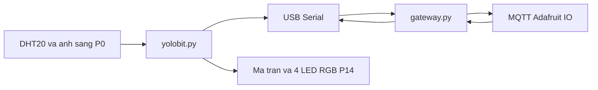

# YOLOHome

Đồ án đa ngành hướng trí tuệ nhân tạo, HK261, Nhóm 1, lớp L01. Mô hình một phòng nhà thông minh trên kit OhStem Yolo:Bit.

Laptop đóng vai IoT Gateway: đọc cảm biến qua cáp USB, đẩy số liệu lên Adafruit IO, so ngưỡng, rồi gửi lệnh đèn xuống board. AI không chạy trên Yolo:Bit.

Đặc tả nhóm nằm ở [User_Requirements.md](User_Requirements.md). Bản nháp báo cáo nằm ở [Bao_cao_NhaThongMinh.md](Bao_cao_NhaThongMinh.md). Checklist thí nghiệm chi tiết hơn nằm ở [code/HUONG_DAN.md](code/HUONG_DAN.md).

## Đã chạy được

Vòng khép kín của Module 1 và Module 2:

1. `code/yolobit.py` chạy trên board. Khoảng mỗi 2 giây in một dòng `T:31.2,H:60,L:44`.
2. `code/gateway.py` chạy trên laptop, đọc dòng đó qua cổng COM.
3. Gateway gửi ba feed `nhiet-do`, `do-am`, `anh-sang` lên Adafruit IO bằng MQTT.
4. Gateway so với ngưỡng. Trong ngưỡng thì feed `canh-bao` là `Bình thường` và board nhận `LED:GREEN`. Vượt ngưỡng thì feed ghi câu tiếng Việt và board nhận `LED:RED`.
5. Đèn ma trận 5x5 và 4 LED RGB trên cổng P14 đổi theo lệnh đó. Vượt ngưỡng: ma trận sáng hết, RGB đỏ nhấp nháy. Trong ngưỡng: một điểm giữa ma trận, RGB xanh lá.

Có hai cách chạy phụ, không thay thế gateway:

| Lệnh | Khi nào dùng |
| --- | --- |
| `python gateway.py` | Cách chạy chính. Cần cắm board và có mạng. |
| `python module1.py` | Chỉ đẩy cảm biến lên cloud, không so ngưỡng, không gửi lệnh đèn. |
| `python module2.py` | Không cần board. Nghe số đã có trên Adafruit rồi cập nhật feed `canh-bao`. Không điều khiển được đèn. |

## Chưa làm

Làm tiếp sau khi vòng ở trên đã thấy số mới trên Adafruit và đèn đổi màu.

| Phần | Trạng thái | Chỗ bắt đầu |
| --- | --- | --- |
| Module 3 — bật tắt đèn, quạt, cửa từ xa | Chưa có feed `den`, `quat`, `cua` và chưa có lệnh serial tương ứng | `gateway.py` đang chỉ gửi `LED:RED` / `LED:GREEN`. Thêm feed trong `config.py`, subscribe trong `gateway.py`, đọc lệnh mới trong `yolobit.py`. |
| Module 4 — nhật ký | Chưa có | Adafruit đã lưu lịch sử từng feed. Nhật ký bật/tắt và nhận diện mặt cần chỗ ghi riêng, hiện chưa có file nào. |
| Module 5 — dashboard | Chưa dựng | Tạo dashboard trên [io.adafruit.com](https://io.adafruit.com) từ các feed key bên dưới. Web riêng làm sau, không phải ứng dụng native. |
| Nhận diện khuôn mặt | Chưa có | Webcam laptop, đúng người thì servo mở cửa. Sai hoặc lỗi thì vẫn mở được bằng nút. Không chạy model trên board. |
| Giọng nói tiếng Việt | Chưa có | Mic laptop, vài lệnh cố định cho đèn và quạt. Không dùng LLM. |
| LCD 16x2 | Chỉ có trong bản thử | `code/board_main_backup.py`. Bản đang nạp (`yolobit.py`) không hiện LCD. |

Tài khoản Adafruit miễn phí tối đa 10 feed và khoảng 30 điểm dữ liệu mỗi phút. Trước khi thêm feed mới, xóa feed cũ không dùng (`temperature`, `humidity`, `light`). Chương trình này không ghi vào ba feed đó.

4 LED RGB cổng P14 đang là đèn cảnh báo của Module 2. Module 3 cũng cần đèn bật tay. Cần chốt dùng chung bốn LED này hay tách đèn cảnh báo sang ma trận, rồi mới gắn relay quạt và servo. Đừng gán quạt vào P0 hoặc P14: P0 là cảm biến ánh sáng, P14 là RGB.

`code/board_main_backup.py` là firmware thử lúc trước (LCD, siêu âm, servo, in JSON). Ánh sáng trong file đó cắm P2 và gửi analog thô. Không nạp file này khi muốn chạy đúng hướng dẫn bên dưới. Siêu âm không nằm trong phạm vi đã chốt của nhóm.

## Kiến trúc đang chạy



Chiều điều khiển hiện có mới là lệnh đèn cảnh báo: Gateway so ngưỡng rồi ghi `LED:RED` hoặc `LED:GREEN` xuống USB. Dashboard và web chưa gửi lệnh quạt hay cửa.

## Phần cứng của bản đang chạy

| Thiết bị | Chỗ cắm |
| --- | --- |
| DHT20 | Một cổng I2C trên mạch mở rộng |
| Cảm biến ánh sáng | P0 |
| 4 LED RGB của kit | P14. Không cắm chung P0 |
| Ma trận 5x5 | Có sẵn trên Yolo:Bit, chỉ có màu đỏ |

Yolo:Bit nối laptop bằng cáp USB. Laptop cần Internet để tới Adafruit.

## Cách chạy

OhStem App và `gateway.py` không được giữ cùng một cổng COM. OhStem chỉ dùng để nạp code. Nạp và lưu xong thì ngắt kết nối OhStem, rồi mới chạy gateway. Giữ nguyên dây USB.

Không chạy `python yolobit.py` trên laptop. File đó là MicroPython của board.

### 1. Môi trường trên laptop

Cần Python 3. Trong PowerShell:

```powershell
cd code
py -3 -m venv .venv
.\.venv\Scripts\python.exe -m pip install -r requirements.txt
copy .env.example .env
```

Mở `.env` và điền:

- `AIO_USERNAME`: username Adafruit IO.
- `AIO_KEY`: Active Key (biểu tượng chìa khóa vàng trên [io.adafruit.com](https://io.adafruit.com)), không phải mật khẩu đăng nhập.
- `COM_PORT`: điền sau bước 3, khi OhStem hiện tên cổng. Mỗi máy một cổng, thường dạng `COM11` hoặc `COM12`.

File `.env` nằm trong `.gitignore`. Không commit, không gửi key lên nhóm chat.

Thư viện laptop: `paho-mqtt`, `pyserial`, `python-dotenv` (xem `code/requirements.txt`).

### 2. Feed trên Adafruit IO

Đúng tên cột **Key**, không phải tên hiển thị.

| Key | Ý nghĩa | Bắt buộc để demo Module 1–2 |
| --- | --- | --- |
| `nhiet-do` | Nhiệt độ, °C | Có |
| `do-am` | Độ ẩm không khí, % | Có |
| `anh-sang` | Ánh sáng, thang 0–100 | Có |
| `canh-bao` | Câu cảnh báo | Có |
| `nguong-nhiet` | Ngưỡng nhiệt. Cao hơn số này thì cảnh báo | Nên có. Không có thì dùng `TEMP_MAX` trong `.env` (mặc định 32) |
| `nguong-am` | Ngưỡng độ ẩm | Không bắt buộc. Không có thì dùng `HUMID_MAX` (mặc định 80) |
| `nguong-sang` | Ngưỡng ánh sáng | Không bắt buộc. Không có thì dùng `LIGHT_MIN` (mặc định 20) |

Gateway tự tạo feed còn thiếu lúc khởi động. Nếu tài khoản đã đủ 10 feed, nó in `Tai khoan da du 10 feed` và bỏ qua; ngưỡng ẩm và sáng vẫn lấy từ `.env`.

Muốn đổi ngưỡng nhiệt không cần sửa code: mở feed `nguong-nhiet`, **Add Data**, ghi số mới (trong khoảng 0–80). Gateway đang chạy sẽ nhận qua MQTT.

Cảnh báo khi nhiệt độ **lớn hơn** ngưỡng, độ ẩm **lớn hơn** ngưỡng, ánh sáng **nhỏ hơn** ngưỡng. Nhiều điều kiện cùng lúc thì `canh-bao` nối bằng ` | `.

### 3. Nạp code lên Yolo:Bit

1. Cắm board vào mạch mở rộng, DHT20 vào I2C, ánh sáng vào P0, 4 LED RGB vào P14, cáp USB vào laptop.
2. Mở [app.ohstem.vn](https://app.ohstem.vn) bằng Chrome hoặc Edge, chọn thiết bị Yolo:Bit, kết nối USB.
3. Ghi lại tên cổng COM. Nếu không thấy cổng, cài driver tại [ohstem.vn/driver](https://ohstem.vn/driver) rồi cắm lại.
4. Sửa `COM_PORT` trong `.env` cho trùng cổng đó.
5. Trên OhStem, chuyển sang chế độ Python. Xóa code mẫu. Mở `code/yolobit.py`, dán toàn bộ vào ô soạn thảo, bấm **Chạy**.
6. Cửa sổ serial phải in khoảng mỗi 2 giây một dòng như `T:31.2,H:60,L:44`. Thiếu độ ẩm vẫn được, ví dụ `T:31.2,L:44`.
7. Nếu báo thiếu `aiot_dht20` hoặc `aiot_rgbled`: vào thư viện, tải **AIOT KIT**, bấm **Chạy** lại. Không có thư viện thì file vẫn đọc DHT20 trực tiếp qua I2C và thử NeoPixel.
8. Thấy dòng `T:...` thì bấm **Lưu project vào thiết bị**.
9. Bấm **ngắt kết nối** trong OhStem. Đóng tab OhStem nếu cổng COM vẫn bị chiếm.

Đúng lúc này ma trận còn một điểm giữa và 4 LED RGB sáng xanh.

### 4. Chạy gateway

OhStem đã ngắt kết nối. PowerShell đang ở thư mục `code`:

```powershell
.\.venv\Scripts\python.exe gateway.py
```

Cửa sổ laptop in lần lượt các dòng kiểu:

```text
Gateway: module 1 + module 2
Da ket noi Adafruit
Dang doc COM12 toc do 115200
Nhan: T:31.2,H:60,L:44
Doc: T=31.2 H=60 L=44
Gui: nhiet-do=31.2, do-am=60, anh-sang=44
Canh bao: Bình thường
Lenh den: GREEN
```

Số và tên cổng tùy máy. `Canh bao` chỉ in lại khi nội dung đổi.

Việc kiểm tra:

- Trên Adafruit, `nhiet-do`, `do-am`, `anh-sang` có điểm mới.
- Hơ tay vào DHT20 cho nhiệt vượt `nguong-nhiet`. Feed `canh-bao` có chữ `Nhiệt độ cao`, ma trận sáng hết, RGB nhấp nháy đỏ.
- Bỏ tay, đợi nhiệt xuống. Feed về `Bình thường`, đèn về xanh.
- Che cảm biến ánh sáng. Dưới ngưỡng (mặc định 20) thì cảnh báo thêm `Ánh sáng thấp`.
- Dừng bằng `Ctrl+C`.

Số không đổi thì gateway không gửi lại ngay. Nhiệt phải lệch ít nhất 0,3°C, ẩm 1%, sáng 2 đơn vị, và hai lần gửi cùng một feed cách nhau ít nhất 2 giây. Dù số đứng yên, cứ khoảng 15 giây vẫn gửi một nhịp để feed không chết. Đây là chủ ý, để khỏi vượt trần 30 điểm/phút. `READ_INTERVAL` trong `.env` (mặc định 3 giây) là nhịp laptop nhận một mẫu, không phải nhịp MQTT.

### 5. Thử Module 2 khi không cầm board

Gateway phải đang tắt, vì hai chương trình không cần cùng gửi `canh-bao`.

```powershell
.\.venv\Scripts\python.exe module2.py
```

Trên Adafruit, thêm một điểm vào `nhiet-do` lớn hơn ngưỡng. Cửa sổ laptop in câu cảnh báo và feed `canh-bao` đổi theo. Đèn trên board không đổi, vì chương trình này không mở cổng COM.

## Giao thức USB

Board gửi, laptop đọc:

```text
T:31.2,H:60,L:44
```

`T` độ C, `H` phần trăm, `L` ánh sáng 0–100. Thiếu một thành phần vẫn hợp lệ. JSON một dòng cũng được nhận, dạng `{"temperature":31.2,"humidity":60,"light":44}`. Bản `yolobit.py` đang nạp không in JSON.

Laptop gửi, board đọc từng dòng:

```text
LED:RED
LED:GREEN
```

Board trả `RGB:RED` hoặc `RGB:GREEN` sau khi đổi đèn. Gateway in dòng đó rồi bỏ qua, không coi là số đo.

## Cấu trúc thư mục `code`

| File | Chạy ở đâu |
| --- | --- |
| `yolobit.py` | Trên board, dán vào OhStem. Đọc cảm biến, vẽ đèn, nghe lệnh LED. |
| `gateway.py` | Laptop. Ghép Module 1 và Module 2. |
| `module1.py` | Laptop. Chỉ thu thập và gửi feed cảm biến. |
| `module2.py` | Laptop. Chỉ so ngưỡng trên số liệu cloud. |
| `config.py` | Không chạy riêng. Đọc `.env`, nối MQTT, tạo và đọc feed. |
| `board_main_backup.py` | Bản thử cũ. Không nạp nếu muốn demo Module 1–2. |
| `.env.example` | Mẫu. Copy thành `.env`. |
| `HUONG_DAN.md` | Checklist cùng nội dung chạy, viết dạng việc cần tick. |

## Lỗi thường gặp

| Dòng in ra | Việc làm |
| --- | --- |
| `Khong mo duoc COM11` | OhStem còn kết nối, hoặc `COM_PORT` sai. Ngắt OhStem, sửa `.env`, chạy lại. |
| `5 giay roi, board khong gui gi qua USB` | Board chưa chạy `yolobit.py`. Nạp lại, lưu, ngắt OhStem, chạy lại gateway. |
| `Board dang o che do nap` | Rút cáp USB, cắm lại, ngắt OhStem, chạy lại. |
| `Bo qua dong nay. Can dang T:31.2,H:60,L:44` | Serial đang in câu khác. Kiểm tra đúng file đã dán lên board. |
| `Khong doc duoc cam bien` | DHT20 chưa ở cổng I2C hoặc ánh sáng chưa ở P0. |
| `Khong ket noi duoc Adafruit` | Xem mạng, username và Active Key. |
| `Tai khoan da du 10 feed` | Xóa feed thừa rồi chạy lại. Ngưỡng vẫn có trong `.env`. |
| Feed không đổi số | Đợi khoảng 15 giây. Số gần như không đổi thì chương trình cố ý không gửi. |

## Tài liệu kit

Lập trình và nạp firmware qua [OhStem App](https://app.ohstem.vn/). Tài liệu kit: [OhStem Education Wiki](https://docs.ohstem.vn/en/latest/tai_lieu_stem/smart_home.html). Giáo trình *AI và IoT cho nhà thông minh* (Yolo:Home) chỉ để làm quen thiết bị. Phạm vi nộp của nhóm là năm module trong `User_Requirements.md` cộng nhận diện mặt và lệnh giọng nói, không phải đủ mọi bài trong sách (bơm, ẩm đất, siêu âm không dùng).
