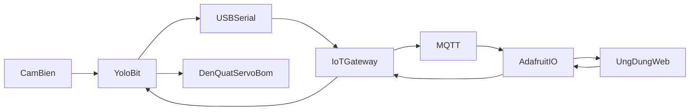

# Đồ án đa ngành YOLOHome

YOLOHome là đồ án nhà thông minh AIoT. Cảm biến và thiết bị thật trong nhà gửi số đo lên đám mây, ứng dụng xem trạng thái và gửi lệnh điều khiển ngược lại, và một tính năng trí tuệ nhân tạo gắn vào cửa ra vào.

Repository này chỉ chứa mô tả đồ án. Chưa có mã nguồn.

## Bài toán

Một ngôi nhà nhỏ cần tự theo dõi điều kiện bên trong và cho người dùng điều khiển thiết bị từ xa. Đồ án ghép các việc đó thành một vòng khép kín:

1. Yolo:Bit đọc nhiệt độ, độ ẩm, ánh sáng và điều khiển đèn, quạt, servo, bơm.
2. Máy tính đóng vai IoT Gateway, nói chuyện với board qua USB Serial.
3. Gateway đẩy dữ liệu lên Adafruit IO bằng MQTT và nhận lệnh từ cloud.
4. Ứng dụng web hiển thị số đo và gửi lệnh.

Lệnh điều khiển đi ngược chiều dữ liệu: ứng dụng, rồi Adafruit IO, rồi Gateway, rồi Yolo:Bit, rồi thiết bị.

Bảng điều khiển Adafruit là chỗ để kiểm tra server trong lúc làm. Ứng dụng web là nơi người dùng xem và bấm lệnh.

Gateway có thể bỏ nếu Yolo:Bit tự gửi MQTT thẳng lên cloud. Bản mô tả này giữ Gateway vì kit nối máy qua cáp USB.

## Kiến trúc

## Phần cứng

Kit OhStem AIoT dùng trong đồ án:

- Yolo:Bit và mạch mở rộng
- Cảm biến nhiệt độ và độ ẩm DHT20
- Cảm biến ánh sáng
- Cảm biến độ ẩm đất
- Cảm biến hồng ngoại và cảm biến khoảng cách
- Màn hình LCD
- Đèn RGB
- Quạt mini và relay
- Động cơ servo
- Máy bơm mini

Năm module chức năng của nhà nằm trên kit này. Tính năng trí tuệ nhân tạo đứng riêng, không tính vào năm module đó.

## Chức năng

- Quan trắc: nhiệt độ, độ ẩm không khí, ánh sáng. Số đo hiện trên LCD và lên cloud.
- Chiếu sáng và quạt: bật tắt đèn, quạt theo lệnh từ xa hoặc theo ngưỡng môi trường.
- Tưới: bơm chạy khi đất khô. Hướng mở rộng của phần này là dự đoán ngày cần tưới.
- Cửa ra vào: servo đóng mở cửa, đèn và LCD báo trạng thái. Cảm biến hồng ngoại hoặc khoảng cách phát hiện người tới gần.

Kênh dữ liệu trên Adafruit IO dùng tên feed cố định, ví dụ `nhiet-do`, `do-am`, `anh-sang`, `den`.

Bản miễn phí của Adafruit IO có trần số bản tin. Chu kỳ gửi cần thưa hơn nhịp đọc cảm biến, đủ để một lần demo khoảng 30 phút mà kết nối MQTT không rớt.

## Tính năng AI

Hướng của môn là trí tuệ nhân tạo.

Tính năng đã chọn: nhận diện khuôn mặt để mở cửa. Khi nhận mặt không chạy, người dùng vẫn mở cửa bằng nút trên web.

## Tài liệu nền

Giáo trình OhStem *AI và IoT cho nhà thông minh* (Yolo:Home) là sách học kit. Sách chia năm phần: thao tác cơ bản trên Yolo:Bit, kết nối mở rộng, kết nối vạn vật, trí tuệ nhân tạo, và hiện thực dự án Yolo:Home. Sách này là tài liệu làm quen thiết bị. Đặc tả môn là năm module chức năng cộng một tính năng AI.

Lập trình khối lệnh trên [OhStem App](https://app.ohstem.vn/), thiết bị Yolo:Bit, thư viện AIoT Kit. Tài liệu kit nằm ở [OhStem Education Wiki](https://docs.ohstem.vn/en/latest/tai_lieu_stem/smart_home.html).
