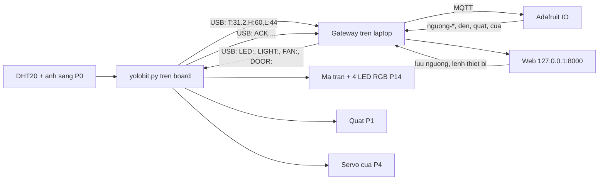

# YOLOHome — Ghi chú kỹ thuật

Nội dung kỹ thuật đã tách khỏi README ngắn, giữ gần nguyên văn để dùng cho báo cáo: cách chạy chi tiết, giao thức, mô hình nhận diện, giọng nói, thư mục mã và các quyết định thiết kế. Hướng dẫn cài đặt ngắn nằm ở [README](../README.md).

Đồ án đa ngành hướng trí tuệ nhân tạo, HK261, Nhóm 1, lớp L01. Mô hình một phòng nhà thông minh trên kit OhStem **Yolo:Bit**.

Laptop đóng vai **IoT Gateway**: đọc cảm biến qua cáp USB, đẩy số liệu lên Adafruit IO, so ngưỡng, gửi lệnh đèn / quạt / cửa xuống board, và chạy web điều khiển. AI không chạy trên Yolo:Bit.

---

## Mục lục

1. [Bắt đầu nhanh](#1-bắt-đầu-nhanh)
2. [Cài đặt một lần trên laptop](#2-cài-đặt-một-lần-trên-laptop)
3. [Chuẩn bị board](#3-chuẩn-bị-board)
4. [Chạy](#4-chạy)
5. [Dùng web](#5-dùng-web)
6. [Lỗi thường gặp](#6-lỗi-thường-gặp)
7. [Giao thức và thư mục](#7-giao-thức-và-thư-mục)
8. [Đã làm và chưa làm](#8-đã-làm-và-chưa-làm)

---

## 1. Bắt đầu nhanh

> **Mọi lệnh trong tài liệu này chạy trong thư mục `code`**, không phải thư mục gốc repo. `requirements.txt`, `.env`, `.venv` đều nằm trong `code/`.
>
> Mở terminal ở gốc repo rồi gõ `cd code`. Kiểm tra: gõ `dir` (PowerShell) hoặc `ls` (Linux/macOS) phải thấy `requirements.txt` và ba thư mục `board`, `yolohome`, `web`.

Chọn đường của bạn, làm đúng các mục theo thứ tự:

| Bạn muốn | Cần board? | Làm theo |
| --- | --- | --- |
| **Demo đầy đủ**: board đọc cảm biến, web hiện số, cảnh báo đổi đèn, điều khiển đèn / quạt / cửa, quét mặt, micro | Có | 2.1 → 2.2 → 2.3 → 3.1 → 3.2 → 4.1. Micro thật: thêm 4.6 |
| Xem và thử giao diện web, không có board trong tay | Không | 2.1 → 2.2 → 4.2 |
| Chạy gateway không có web, điều khiển bằng dashboard Adafruit | Có | 2.1 → 2.2 → 2.3 → 3.1 → 3.2 → 4.3 |

Lệnh viết cho **PowerShell** trên Windows. Dùng **Linux / macOS**: thay `.\.venv\Scripts\python.exe` bằng `./.venv/bin/python`; phần riêng cho Linux nằm ở 2.1 và 3.3.

**Ba quy tắc luôn nhớ:**

- Mỗi lúc chỉ **một** chương trình giữ cổng COM: OhStem, `python -m yolohome.gateway` hoặc `python -m yolohome`. OhStem chỉ dùng để nạp code; nạp xong phải ngắt.
- **Không** chạy `board/yolobit.py` trên laptop. File đó là MicroPython, chỉ chạy trên board.
- Web chỉ mở được trên chính laptop chạy nó (`http://127.0.0.1:8000`), không mở từ điện thoại hay máy khác. Đây là chủ ý, để không ai trong Wi-Fi mở cửa được.

---

## 2. Cài đặt một lần trên laptop

### 2.1 Python và thư viện

Cần **Python 3** (khuyên dùng 3.11 trở lên) và Internet. Thư viện nằm trong `code/requirements.txt`: `paho-mqtt`, `pyserial`, `python-dotenv`, `opencv-python`, `numpy`. Trang web không cần Node hay npm. Giọng nói cài thêm `code/requirements-voice.txt` (mục 4.6). Chưa cài thì web vẫn chạy, chỉ nút micro báo thiếu thư viện.

**Windows** (PowerShell, đứng ở gốc repo):

```powershell
cd code
py -3 -m venv .venv
.\.venv\Scripts\python.exe -m pip install -r requirements.txt
copy .env.example .env
```

> Luôn chạy bằng `.\.venv\Scripts\python.exe`, không gõ `python` trần. Trên một số máy, `python` là bản của MSYS2 và không có pip.

**Linux / macOS** (bash, đứng ở gốc repo):

```bash
cd code
python3 -m venv .venv
./.venv/bin/python -m pip install -r requirements.txt
cp .env.example .env
```

> - Ubuntu/Debian báo thiếu `venv`: `sudo apt install python3-venv python3-pip`.
> - Luôn chạy bằng `./.venv/bin/python`, không gõ `python` trần (nhiều distro chỉ có `python3`).
> - **WSL2** (Linux chạy trong Windows): WSL không thấy cổng USB sẵn. Muốn dùng board thật, cài [usbipd-win](https://learn.microsoft.com/windows/wsl/connect-usb) rồi gắn Yolo:Bit vào WSL (`usbipd attach --wsl --busid <BUSID>`); không thì chạy chế độ giả lập ở 4.2. Trình duyệt ở Windows vẫn mở được `http://127.0.0.1:8000` của web chạy trong WSL2.

### 2.2 File `.env`

Mở file `code/.env` bằng Notepad/VS Code (Linux: `nano`, `gedit`, VS Code...) và điền:

| Dòng | Điền gì |
| --- | --- |
| `AIO_USERNAME` | Username Adafruit IO của nhóm |
| `AIO_KEY` | **Active Key** (biểu tượng chìa khóa vàng trên [io.adafruit.com](https://io.adafruit.com)), không phải mật khẩu đăng nhập |
| `COM_PORT` | Để tạm. Điền ở 3.2, khi OhStem hiện tên cổng (Windows thường `COM11`, `COM12`; Linux `/dev/ttyACM0` hoặc `/dev/ttyUSB0`; macOS `/dev/cu.usbmodem...`; mỗi máy một khác) |
| `WEB_PASSWORD` | Mật khẩu **riêng** để đăng nhập web. Không dùng lại `AIO_KEY` |
| `WEB_DATA` | `mock`, `gateway` hoặc `live` (xem bảng ở mục 4) |

Các dòng còn lại (tên feed, ngưỡng mặc định, `WEB_PORT`...) để nguyên như `.env.example`. Biến khuôn mặt `FACE_*` giải thích ở mục 4.5. Biến giọng nói `VOICE_*` giải thích ở mục 4.6. Cả hai nhóm đã có giá trị mặc định trong `.env.example`.

> **Bảo mật:** `.env` đã nằm trong `.gitignore`. Không commit, không gửi key lên nhóm chat, không chụp màn hình có key. Xin username/key từ trưởng nhóm qua tin nhắn riêng.

### 2.3 Feed trên Adafruit IO

Chỉ cần làm một lần cho tài khoản của nhóm. Tên phải đúng cột **Key**, không phải tên hiển thị.

| Key | Ý nghĩa | Bắt buộc? |
| --- | --- | --- |
| `nhiet-do` | Nhiệt độ, °C | Có |
| `do-am` | Độ ẩm không khí, % | Có |
| `anh-sang` | Ánh sáng, thang 0–100 | Có |
| `canh-bao` | Câu cảnh báo (`Bình thường` hoặc nội dung vượt ngưỡng) | Có |
| `nguong-nhiet` | Cảnh báo khi nhiệt độ **>** số này (0–80) | Nên có. Không có thì dùng `TEMP_MAX` trong `.env` (32) |
| `nguong-am` | Cảnh báo khi độ ẩm **>** số này (0–100) | Không bắt buộc. Không có thì dùng `HUMID_MAX` (80) |
| `nguong-sang` | Cảnh báo khi ánh sáng **<** số này (0–100) | Không bắt buộc. Không có thì dùng `LIGHT_MIN` (20) |
| `den` | Đèn (Module 3): `OFF` hoặc một trong 4 màu `#ffffff`, `#b8860b`, `#9333ea`, `#2563eb` | Có, cho Module 3 |
| `quat` | Quạt (Module 3): tốc độ 0–100 %, `0` = tắt | Có, cho Module 3 |
| `cua` | Cửa (Module 3): `OPEN` hoặc `CLOSE` | Có, cho Module 3 |

- Đủ cả bảng là **10/10 feed**, đúng giới hạn bản miễn phí. Không còn chỗ cho feed mới.
- Gateway tự tạo feed còn thiếu lúc khởi động. Nếu tài khoản đã đủ 10 feed, nó in `Tai khoan da du 10 feed` và bỏ qua.
- Phải xóa các feed cũ không dùng `temperature`, `humidity`, `light` thì mới đủ chỗ cho bảng trên.
- `den`, `quat`, `cua` ghi **trạng thái thật** của thiết bị: gateway chỉ cập nhật sau khi board xác nhận (`ACK:`). Lúc khởi động gateway đặt `OFF`, `0`, `CLOSE`.
- Bản miễn phí chỉ cho khoảng **30 điểm dữ liệu mỗi phút**. Chương trình đã tự giới hạn; đừng tự thêm vòng gửi dữ liệu.
- Dashboard Adafruit: vào [io.adafruit.com](https://io.adafruit.com) → Dashboards → New Dashboard, tên `YOLOHome`. Hàng 1: ba Gauge cho `nhiet-do` (0–50), `do-am` (0–100), `anh-sang` (0–100). Hàng 2: Text `canh-bao`, Line Chart ba feed cảm biến. Hàng 3: Slider `nguong-nhiet` (0–80), `nguong-am` (0–100), `nguong-sang` (0–100). Hàng 4: Toggle `den` (bật `#ffffff`, tắt `OFF`), Slider `quat` (0–100, bước 10), Toggle `cua` (bật `OPEN`, tắt `CLOSE`). Không dùng Color Picker cho đèn.

---

## 3. Chuẩn bị board

Bỏ qua mục này nếu chỉ chạy giả lập (4.2).

### 3.1 Cắm dây

| Thiết bị | Chỗ cắm |
| --- | --- |
| DHT20 (nhiệt, ẩm) | Một cổng **I2C** trên mạch mở rộng |
| Cảm biến ánh sáng | **P0** |
| 4 LED RGB | **P14**. Không cắm chung P0. Dùng chung cho cảnh báo và đèn thủ công; cảnh báo được ưu tiên (D3) |
| Quạt (PWM) | **P1** (D4) |
| Servo cửa | **P4**, hàng servo (D4) |
| Ma trận 5x5 | Có sẵn trên Yolo:Bit. Luôn hiện trạng thái cảnh báo |

Cắm Yolo:Bit vào mạch mở rộng, cắm các thiết bị theo bảng, rồi cắm cáp USB vào laptop. Không gán thiết bị mới vào P0 hoặc P14. Quạt và servo không khởi động cùng lúc (cách nhau ít nhất 0,5 giây).

### 3.2 Nạp `yolobit.py` bằng OhStem

1. Mở [app.ohstem.vn](https://app.ohstem.vn) bằng Chrome hoặc Edge, chọn **Yolo:Bit**, bấm kết nối **USB**.
2. Ghi lại tên cổng COM hiện ra. Không thấy cổng thì cài driver tại [ohstem.vn/driver](https://ohstem.vn/driver) rồi cắm lại. Dùng Linux: tìm cổng theo 3.3.
3. Sửa `COM_PORT` trong `code/.env` cho trùng cổng đó, lưu file.
4. Trên OhStem chuyển sang chế độ **Python**. Xóa code mẫu. Mở `code/board/yolobit.py`, chọn hết, dán vào ô soạn thảo, bấm **Chạy**.
5. Mở cửa sổ serial. Khoảng mỗi 2 giây phải có một dòng như `T:31.2,H:60,L:44` (thiếu độ ẩm, ví dụ `T:31.2,L:44`, vẫn được).
6. Báo thiếu `aiot_dht20` / `aiot_rgbled`: vào thư viện, tải **AIOT KIT**, bấm **Chạy** lại.
7. Thấy dòng `T:...` thì bấm **Lưu project vào thiết bị**.
8. Bấm **ngắt kết nối** trong OhStem. Giữ nguyên dây USB. Cổng vẫn bị chiếm thì đóng hẳn tab OhStem.

Đúng khi ma trận 5x5 sáng một điểm ở giữa, 4 LED RGB **tắt** (đèn thủ công mặc định tắt), quạt đứng yên, cửa đóng. Nếu 4 LED sáng xanh lá thì board đang chạy `yolobit.py` cũ: nạp lại.

> **Không** nạp `code/board/board_main_backup.py` (bản thử cũ, cảm biến cắm khác chân).

### 3.3 Tìm cổng trên Linux

Thay cho bước 2–3 ở trên:

- OhStem trên Chrome/Edge không hiện tên cổng kiểu `/dev/...`. Rút cáp, chạy `ls /dev/ttyACM* /dev/ttyUSB*`, cắm lại, chạy lệnh lần nữa; cổng mới xuất hiện là `COM_PORT` (ví dụ `COM_PORT=/dev/ttyACM0`). Hoặc xem `dmesg | tail`.
- Báo `Permission denied`: thêm tài khoản vào nhóm `dialout` rồi **đăng xuất và đăng nhập lại**: `sudo usermod -aG dialout $USER` (Arch: nhóm `uucp`). Kiểm tra bằng lệnh `groups`.
- Cổng biến mất ngay sau khi cắm: `brltty` đang chiếm, gỡ bằng `sudo apt remove brltty`.
- Chrome/Chromium bản **snap** hay **flatpak** có thể không thấy cổng serial; dùng bản `.deb` của Google Chrome hoặc Chrome/Edge tải từ trang chủ.

---

## 4. Chạy

Đứng trong thư mục `code`. Chọn một chế độ:

| Chế độ | Lệnh | `WEB_DATA` | Cần board? | Điều khiển đèn / quạt / cửa | Mục |
| --- | --- | --- | --- | --- | --- |
| **Web cùng board** (demo chính) | `python -m yolohome` | `gateway` | Có | Có, từ web và dashboard | 4.1 |
| Web giả lập | `python -m yolohome` | `mock` | Không | Giả lập | 4.2 |
| Gateway không web | `python -m yolohome.gateway` | (không dùng) | Có | Có, từ dashboard Adafruit | 4.3 |
| Web chỉ đọc, gateway chạy riêng | `python -m yolohome` | `live` | Không (gateway ở nơi khác) | Chưa | 4.3 |
| Chỉ gửi cảm biến | `python -m yolohome.module1` | (không dùng) | Có | Không | 4.3 |
| Chỉ cảnh báo từ số trên Adafruit | `python -m yolohome.module2` | (không dùng) | Không | Không | 4.3 |

Dừng chương trình bằng `Ctrl+C`. Muốn đổi chế độ thì tắt chương trình đang chạy trước, vì hai chương trình không giữ chung được cổng COM.

### 4.1 Web cùng board (cách demo chính)

Một lệnh duy nhất: web chạy luôn Module 1 + 2 + 3 (đọc board, gửi Adafruit, so ngưỡng, đổi đèn cảnh báo, điều khiển đèn / quạt / cửa), nút quét mặt (mục 4.5), nút micro (mục 4.6) và hiện số lên trình duyệt.

1. Làm xong 3.2, OhStem đã ngắt kết nối.
2. Trong `code/.env`: `WEB_DATA=gateway`, có `WEB_PASSWORD`, `COM_PORT` đúng.
3. Chạy:

   ```powershell
   .\.venv\Scripts\python.exe -m yolohome
   ```

4. Mở trình duyệt **trên chính laptop đó**: `http://127.0.0.1:8000`, đăng nhập bằng `WEB_PASSWORD`.

Không cắm board cũng mở được trang: chương trình in `Khong co board` rồi vẫn phục vụ web. Nút **Quét mặt mở cửa** hiện khi `FACE_ENABLE=1` (mặc định) và OpenCV cùng mô hình tải được. Webcam mở lúc bấm quét, không phải lúc mở trang. `FACE_LIVENESS` mặc định `0` (tắt thử thách quay đầu). Nút micro cũng hiện ở chế độ này. Nghe mic thật thì làm mục 4.6. Đèn, quạt và cửa không phản hồi cho đến khi có cổng COM.

Cửa sổ PowerShell in lần lượt các dòng kiểu:

```text
Web - Module 5
Du lieu: chay luon Module 1 + 2 tren cong COM12
Gateway: module 1 + module 2 + module 3
Dang doc COM12 toc do 115200
Da ket noi Adafruit
Nhan: T:31.2,H:60,L:44
Doc: T=31.2 H=60 L=44
Gui: nhiet-do=31.2, do-am=60, anh-sang=44
Canh bao: Bình thường
Lenh den: GREEN
Mo trinh duyet: http://127.0.0.1:8000
```

**Kiểm tra nhanh:**

- [ ] Thẻ nhiệt độ, độ ẩm, ánh sáng trên web đổi theo board trong vòng 5 giây; trên Adafruit `nhiet-do`, `do-am`, `anh-sang` có điểm mới.
- [ ] Hơ tay vào DHT20 cho vượt ngưỡng: web hiện thẻ đỏ "VƯỢT NGƯỠNG!", có thông báo góc phải; ma trận sáng hết, 4 LED RGB nháy đỏ; feed `canh-bao` có chữ `Nhiệt độ cao`. Bỏ tay ra: tất cả về bình thường.
- [ ] Bấm **Cấu hình ngưỡng**, lưu ngưỡng nhiệt cao hơn số đang đo: feed `nguong-nhiet` đổi, board hết cảnh báo.
- [ ] Bật đèn, đổi màu; kéo thanh quạt rồi thả; bấm mở cửa. Mỗi thiết bị phản ứng trong 3 giây, thẻ trên web và feed `den` / `quat` / `cua` khớp trạng thái thật. Cửa tự đóng sau 10 giây.
- [ ] Nút **Quét mặt mở cửa** (mục 4.5): đúng thành viên thì cửa mở, không khớp thì cửa giữ đóng và thẻ hiện lý do. Nút mở cửa bằng tay vẫn bấm được. `FACE_ENABLE=0` hoặc thiếu OpenCV thì thẻ khuôn mặt tắt, nút cửa vẫn dùng được.
- [ ] Nút micro (mục 4.6), sau khi cài `requirements-voice.txt`: nói "bật đèn", "tắt đèn", "bật quạt" hoặc "tắt quạt". Đèn hoặc quạt đổi sau khi board xác nhận. Câu khác không gửi lệnh.

Đang có cảnh báo thì 4 LED luôn nháy đỏ, kể cả khi vừa bật đèn màu khác; hết cảnh báo chúng về màu đã chọn. Góc cửa và tốc độ quạt nằm ở đầu phần Module 3 trong `board/yolobit.py`: `ANGLE_CLOSE` 0, `ANGLE_OPEN` 90, `PWM_MAX` 1023, `SERVO_RELEASE_MS` 1500. Sửa trên OhStem rồi nạp lại nếu cửa không khép hoặc quạt đã quay hết tốc ở mức thấp.

### 4.2 Web giả lập (không cần board)

Dùng để xem và thử giao diện khi không có board. Không gửi gì lên Adafruit.

1. Trong `code/.env`: `WEB_DATA=mock` (mặc định) và có `WEB_PASSWORD`. Vẫn cần `AIO_USERNAME`, `AIO_KEY` có giá trị (chương trình kiểm tra lúc khởi động).
2. Chạy `.\.venv\Scripts\python.exe -m yolohome`, mở `http://127.0.0.1:8000`.

Ở chế độ này cảm biến, đèn, quạt, cửa và nút micro đều giả lập: cảm biến đổi nhẹ mỗi 3 giây; bật/tắt đèn, đổi màu, chỉnh tốc độ quạt, mở cửa (tự khóa sau 10 giây) đều chạy. Quét mặt không chạy ở `mock`. Có các nút để thử:

| Nút | Thử điều gì |
| --- | --- |
| **Mô phỏng vượt ngưỡng nhiệt độ** (dưới thẻ cảm biến) | Nhiệt lên quá ngưỡng 30 giây: thẻ đỏ, đèn đỏ, thông báo |
| **Test Offline** (trên header) | Mất kết nối: banner đỏ, thẻ thiết bị mờ, không gửi được lệnh |
| Nút **micro** | Không mở mic. Lần lượt giả lập "bật đèn", "tắt đèn", "bật quạt", "tắt quạt" |

### 4.3 Các cách chạy khác

| Lệnh | Khi nào dùng |
| --- | --- |
| `.\.venv\Scripts\python.exe -m yolohome.gateway` | Chạy Module 1 + 2 + 3 không có web (giống 4.1 nhưng không có trang web). In và gửi y hệt. Điều khiển thiết bị bằng dashboard Adafruit ở mục 2.2. |
| `WEB_DATA=live` + `python -m yolohome` | Khi `python -m yolohome.gateway` đang chạy riêng (cửa sổ khác hoặc máy khác). Web chỉ đọc số từ Adafruit, mất kết nối nếu 45 giây không có số mới. Chưa điều khiển được đèn / quạt / cửa. Quét mặt và micro cũng không có: cả hai chỉ chạy khi `WEB_DATA=gateway`. Không chạy chung với `WEB_DATA=gateway`. |
| `.\.venv\Scripts\python.exe -m yolohome.module1` | Chỉ đẩy cảm biến lên Adafruit, không so ngưỡng, không đổi đèn. |
| `.\.venv\Scripts\python.exe -m yolohome.module2` | Không cần board. Nghe số đang có trên Adafruit rồi cập nhật `canh-bao`. Tắt gateway trước. Thử: thêm một điểm vào `nhiet-do` lớn hơn ngưỡng trên Adafruit. |

### 4.4 Đổi ngưỡng và nhịp gửi dữ liệu

Đổi ngưỡng không cần sửa code: dùng nút **Cấu hình ngưỡng** trên web, hoặc trên Adafruit mở feed `nguong-nhiet` → **Add Data** → ghi số mới. Gateway đang chạy nhận ngay.

Gateway không gửi lại khi số gần như không đổi: nhiệt phải lệch ≥ 0,3°C, ẩm ≥ 1%, sáng ≥ 2; cùng một feed cách nhau ≥ 2 giây; số đứng yên thì cứ ~15 giây gửi một nhịp. Đây là chủ ý để không vượt 30 điểm/phút. `READ_INTERVAL` (mặc định 3 giây) là nhịp laptop lấy mẫu, không phải nhịp gửi.

---

### 4.5 Nhận diện khuôn mặt (Phase 6)

Người làm tiếp đọc `docs/phase-6-ban-giao.md` trước khi sửa phần này.

AI chạy trên laptop, dùng webcam của laptop: YuNet (phát hiện mặt) + SFace (vector 128 số), hai mô hình ONNX đã huấn luyện sẵn của OpenCV. Lần chạy đầu tự tải vào `code/models/` (khoảng 37 MB). Ảnh và vector khuôn mặt nằm trong `code/data/faces/`. Hai thư mục này đã có trong `.gitignore`, không đẩy lên GitHub. Không tốn feed Adafruit nào.

Đứng trong thư mục `code`:

```powershell
# 1. Đăng ký từng thành viên (tên không dấu): 25 ảnh qua 5 bước tư thế
.\.venv\Scripts\python.exe -m yolohome.face.enroll Minh
.\.venv\Scripts\python.exe -m yolohome.face.enroll --list

# 2. Thử quét, không cần board
.\.venv\Scripts\python.exe -m yolohome.face.unlock

# 3. Buổi khác, ánh sáng phòng demo: ảnh test thành viên và người lạ (tên chưa đăng ký = người lạ)
.\.venv\Scripts\python.exe -m yolohome.face.enroll Minh --test
.\.venv\Scripts\python.exe -m yolohome.face.enroll la1 --test

# 4. Đánh giá + chọn ngưỡng: data/faces/eval_report.md, eval_plot.png, threshold.json
.\.venv\Scripts\python.exe -m yolohome.face.evaluate
```

Đăng ký theo tư thế: nhìn thẳng → quay một bên → quay bên kia → lùi xa → đổi kính (đang đeo thì tháo ra, không đeo thì đeo vào, nhìn thẳng). Bước đổi kính không bắt buộc: không có kính thì bấm **Bỏ qua bước**. Hai kiểu được lưu thành hai mẫu; lúc quét lấy điểm cao hơn, nên lệch khoảng 0,15 giữa có kính và không kính không kéo cả hai xuống một mẫu trộn. Chương trình đo góc quay đầu từ 5 điểm mốc; sai tư thế thì không chụp và không sang bước. Thiếu bước nhìn thẳng hoặc dưới 10 ảnh thì không lưu. Mẫu đăng ký trước khi có bước kính vẫn là một mẫu: muốn cả hai kiểu thì đăng ký lại.

Mở cửa: mỗi thành viên có một mẫu trung bình; trong 7 khung liên tiếp phải có 5 khung khớp **cùng một** thành viên với điểm ≥ ngưỡng. Điểm là độ giống cosine (1 là trùng hướng), không phải phần trăm. Ngưỡng lấy từ `threshold.json` do bước 4 chọn (cao hơn mọi người lạ trong nửa dữ liệu hiệu chỉnh, không thấp hơn 0,363); chưa chạy bước 4 thì dùng 0,70. Muốn siết hoặc nới tay thì ghi `FACE_THRESHOLD` trong `.env` (số này thắng cả file và mặc định). `FACE_LIVENESS=1` thêm thử thách quay đầu chống ảnh in (mặc định tắt). Biểu đồ ở bước 4 cần `pip install matplotlib`, không có thì bỏ qua biểu đồ.

Trong gateway: `Gateway.start()` mở phần này; đúng thành viên thì gửi `DOOR:OPEN` qua Module 3 như lệnh từ web, nguồn `Khuôn mặt`, board tự đóng sau 10 s. Trên web (`WEB_DATA=gateway`) thẻ khuôn mặt có hai nút: **Quét mặt mở cửa** và **Đăng ký mới**. **Đăng ký mới** mở cửa sổ nhập tên không dấu và mật khẩu chủ nhà (`WEB_PASSWORD`). Đúng mật khẩu thì webcam mới mở trong một cửa sổ riêng. Các bước đăng ký nằm cạnh hình. Nhìn thẳng, quay trái, quay phải, lùi xa, rồi đổi kính. Không có kính thì bấm **Bỏ qua bước**. Nút **Bỏ qua bước** và **Hủy** nằm trong cửa sổ đó. Kết quả hiện trên thẻ và trong nhật ký. Lệnh dòng lệnh vẫn mở cửa sổ riêng và dùng phím S / Q. Sai mật khẩu năm lần trong một phút thì đăng nhập và đăng ký cùng bị khóa tạm. Chạy riêng `python -m yolohome.gateway` thì gõ `f` rồi Enter để quét; đăng ký từ dòng lệnh vẫn dùng lệnh ở trên. Mặc định `FACE_ENABLE=1`. Thiếu OpenCV, thiếu mô hình hay `FACE_ENABLE=0` thì chỉ tắt phần này: thẻ báo cần `WEB_DATA=gateway` và `FACE_ENABLE=1`, nút cửa trên web vẫn dùng được. `FACE_LIVENESS` mặc định `0`. Đặt `1` thì phải quay đầu đủ `FACE_LIVE_SPREAD` (mặc định 0,30) mới mở cửa.

### 4.6 Giọng nói tiếng Việt (Phase 7)

Đã gắn vào web. Laptop nghe mic bằng **faster-whisper**, chạy offline sau khi mô hình đã có trên máy. Không dùng LLM. Không chạy trên Yolo:Bit. Đúng bốn lệnh: **bật đèn**, **tắt đèn**, **bật quạt**, **tắt quạt**. Cửa không có lệnh giọng nói.

Người làm tiếp đọc `docs/plans/phase-7-giong-noi.md` khi cần tải PhoWhisper hoặc đo trên kit. Phần dưới đủ để cài và chạy.

**Cài thêm**, một lần. Web cảm biến vẫn chạy nếu bỏ qua bước này.

Từ gốc repo:

```text
pip install -r code/requirements-voice.txt
```

Đứng trong `code`, dùng venv của mục 2.1:

```powershell
.\.venv\Scripts\python.exe -m pip install -r requirements-voice.txt
```

Linux / macOS: `./.venv/bin/python -m pip install -r requirements-voice.txt`

**Thử mic**, không cần board, không cần Adafruit. Đứng trong `code`:

```text
python -m yolohome.voice.probe
```

Với venv: `.\.venv\Scripts\python.exe -m yolohome.voice.probe` (Linux / macOS: `./.venv/bin/python -m yolohome.voice.probe`). Nhấn Enter, nói một trong bốn lệnh. Probe in câu nghe được và lệnh dự kiến. Gõ `q` để thoát. Lần đầu, nếu chưa có mô hình và có Internet, probe có thể tải Whisper `small`. Web không tải mô hình: chỉ dùng file đã có sẵn trên máy.

Trên web:

| `WEB_DATA` | Nút micro |
| --- | --- |
| `gateway` | Mic thật. Bấm một lần, nói một lệnh. Đèn bật lại màu đã chọn, quạt bật lại tốc độ đã chọn. Câu ngoài bốn lệnh không gửi gì. |
| `mock` | Không mở mic. Mỗi lần bấm lấy lần lượt một câu trong bốn lệnh, để thử giao diện. |
| `live` | Không có. Thẻ bảo chạy `WEB_DATA=gateway`. |

`VOICE_ENABLE=0` thì gateway không mở mic. Nút đèn và quạt vẫn dùng được. Terminal in `Giong noi: tat (VOICE_ENABLE=0)`. Khi bật và nạp xong, terminal in `Giong noi: san sang (...)`.

Biến trong `code/.env` (mẫu ở `.env.example`, đọc bởi `code/yolohome/config.py`):

| Biến | Mặc định | Ý nghĩa |
| --- | --- | --- |
| `VOICE_ENABLE` | `1` | `1` bật mic trên web. `0` tắt mic. Nút đèn và quạt vẫn dùng được. |
| `VOICE_MODEL` | trống | Trống: nếu thư mục PhoWhisper có `model.bin` thì dùng thư mục đó, chưa có thì `small` (Whisper small). Có thể ghi `small` hoặc đường dẫn thư mục CTranslate2. |
| `VOICE_MIC` | trống | Trống: mic mặc định. Số: thứ tự trong `python -m sounddevice`. Chữ: một phần tên mic. |
| `VOICE_SECONDS` | `3` | Số giây thu mỗi lượt. Số nhỏ hơn 1 được đưa lên 1. |
| `VOICE_VAD` | `1` | `1` bật bộ lọc tiếng nói. `0` tắt, chỉ để chẩn đoán. |
| `VOICE_HINTS` | `0` | `1` gợi ý hai từ "đèn" và "quạt" cho Whisper (giống probe `--hint-devices`). |

Thư mục PhoWhisper khi `VOICE_MODEL` để trống: `%LOCALAPPDATA%\YOLOHome\models\phowhisper-small-ct2` trên Windows. Không có biến `LOCALAPPDATA` (Linux, macOS) thì là `~/YOLOHome/models/phowhisper-small-ct2`. Cách tạo thư mục đó nằm ở `docs/plans/phase-7-giong-noi.md`, bước 2.

## 5. Dùng web

| Trang | Nội dung |
| --- | --- |
| `/` | Bảng điều khiển: cảm biến, trạng thái LED, điều khiển thiết bị, khuôn mặt, giọng nói, nhật ký gần nhất |
| `/log.html` | Nhật ký: lọc theo loại, ngày, tìm chữ, phân trang |
| `/login.html` | Đăng nhập bằng `WEB_PASSWORD` |
| `/components.html` | Xem nút, nhãn, công tắc theo Figma (cho người làm giao diện) |

Những gì web hiện, theo `WEB_DATA`:

| Phần | Trạng thái |
| --- | --- |
| Nhiệt độ, độ ẩm, ánh sáng, cảnh báo, đèn LED cảnh báo | Có ở `gateway` và `live` (Module 1–2). Ở `mock`: số giả lập |
| Cấu hình ngưỡng | Ở `gateway` và `live`: lưu thẳng lên feed `nguong-*`. Feed nào tài khoản chưa có thì web báo rõ, không tự tạo. Ở `mock`: chỉ đổi trong phiên web |
| Nhật ký cảm biến | Ở `gateway` và `live`: lấy lịch sử từ Adafruit mỗi lần mở web. Ở `mock`: số giả lập trong RAM |
| Nhật ký điều khiển, cảnh báo, khuôn mặt, giọng nói | Chỉ trong RAM, tắt web là mất (nơi lưu lâu dài chưa chốt, D5) |
| Đèn, quạt, cửa | Có ở `gateway`: thẻ chỉ đổi khi board xác nhận; cùng một thiết bị phải cách nhau 2 giây. Ở `mock`: giả lập. Ở `live`: chưa điều khiển được |
| Khuôn mặt | Có ở `gateway` khi `FACE_ENABLE=1` (mặc định) và OpenCV cùng mô hình tải được: **Quét mặt mở cửa**, **Đăng ký mới** (mục 4.5). `FACE_LIVENESS` mặc định `0`. Ở `mock` và `live`: thẻ báo cần `WEB_DATA=gateway` |
| Giọng nói | Có ở `gateway`: nút micro, faster-whisper offline, bốn lệnh bật/tắt đèn và bật/tắt quạt (mục 4.6). `VOICE_ENABLE` mặc định `1`. Ở `mock`: nút micro giả lập, không mở mic. Ở `live`: không có |

Sai mật khẩu 5 lần trong 1 phút thì bị chặn 1 phút. Phiên đăng nhập giữ 12 giờ; tắt `python -m yolohome` thì phải đăng nhập lại.

---

## 6. Lỗi thường gặp

| Dòng in ra / hiện tượng | Việc làm |
| --- | --- |
| `ERROR: Could not open requirements file` | Đang đứng ở gốc repo. `cd code` rồi chạy lại (mục 1). |
| `Thieu AIO_USERNAME trong file .env` | Chưa copy `.env.example` thành `.env`, hoặc chưa điền username/key (2.2). |
| `Thieu WEB_PASSWORD trong file .env` | Thêm dòng `WEB_PASSWORD=...` vào `.env`. |
| `Khong mo duoc COM11` | OhStem hoặc `python -m yolohome.gateway` còn giữ cổng, hoặc `COM_PORT` sai. Ngắt OhStem, tắt chương trình kia, sửa `.env`, chạy lại. |
| `Permission denied: '/dev/ttyACM0'` (Linux) | Chưa có quyền đọc cổng. `sudo usermod -aG dialout $USER`, đăng xuất rồi đăng nhập lại (3.3). |
| `No such file or directory: '/dev/ttyACM0'` (Linux) | Sai tên cổng, hoặc đang ở WSL2 chưa gắn USB. Tìm lại bằng `ls /dev/ttyACM* /dev/ttyUSB*` (3.3). |
| `python3 -m venv` báo `ensurepip is not available` (Linux) | `sudo apt install python3-venv python3-pip`, xóa thư mục `.venv` cũ rồi tạo lại. |
| `5 giay roi, board khong gui gi qua USB` | Board chưa chạy `yolobit.py`. Nạp lại, **Lưu project vào thiết bị**, ngắt OhStem, chạy lại. |
| `Board dang o che do nap` | Rút cáp USB, cắm lại, ngắt OhStem, chạy lại. |
| `Bo qua dong nay. Can dang T:31.2,H:60,L:44` | Board đang in câu khác. Kiểm tra đúng file `yolobit.py` đã dán lên board. |
| `Khong doc duoc cam bien` | DHT20 chưa ở cổng I2C hoặc ánh sáng chưa ở P0. |
| `Board khong tra loi lenh FAN:100 sau 3 giay` (hoặc `DOOR:`, `LIGHT:`); web báo "Thiết bị không phản hồi sau 3 giây" | Board chạy `yolobit.py` cũ (chưa có Module 3), hoặc thiết bị chưa cắm đúng P1 / P4. Nạp lại `yolobit.py`, kiểm tra dây. Feed tự quay về trạng thái thật. |
| `Loi quat P1: ...` / `Loi servo P4: ...` trên serial của board | Quạt hoặc servo chưa cắm, hoặc cắm sai cổng. |
| `Vừa gửi lệnh. Đợi 2 giây rồi bấm lại.` trên web | Bấm cùng một thiết bị quá nhanh. Cố ý, để không vượt 30 điểm/phút. |
| Quạt đặt số nhỏ mà không quay | Cánh cần lực để bắt đầu quay. Dùng số lớn hơn. Nếu mức thấp đã quay hết tốc, xem `PWM_MAX` ở mục 4.1. |
| `Khong ket noi duoc Adafruit` | Kiểm tra mạng, username và **Active Key** (không phải mật khẩu). |
| `Tai khoan da du 10 feed` | Xóa feed thừa (`temperature`, `humidity`, `light`) rồi chạy lại. Ngưỡng vẫn lấy từ `.env`. |
| Feed trên Adafruit không đổi số | Đợi ~15 giây. Số gần như không đổi thì chương trình cố ý không gửi. |
| `Khong mo duoc cong 8000` | Chương trình khác dùng cổng. Thêm `WEB_PORT=8001` vào `.env`, mở `http://127.0.0.1:8001`. |
| Web báo mất kết nối (`gateway`) | Board không gửi số quá 10 giây. Xem PowerShell có dòng `Nhan: T:...` không. |
| Web báo mất kết nối (`live`) | `python -m yolohome.gateway` chưa chạy hoặc board không gửi số. |
| `Sai quá nhiều lần` trên trang đăng nhập | Đợi 1 phút rồi thử lại. |
| Thẻ micro báo thiếu thư viện (`requirements-voice.txt`) | Đứng trong `code`: `python -m pip install -r requirements-voice.txt`. Từ gốc repo: `pip install -r code/requirements-voice.txt`. Nút đèn và quạt vẫn dùng được. |
| `Chưa có mô hình` hoặc thẻ micro không chuyển sang sẵn sàng | Web chỉ nạp mô hình đã có trên máy. Tải một lần khi có mạng theo `docs/plans/phase-7-giong-noi.md`, bước 2, rồi chạy lại. |
| `Giọng nói đang tắt (VOICE_ENABLE=0 trong .env)` | Đặt `VOICE_ENABLE=1` rồi chạy lại web. |
| `py` không phải là lệnh | Chưa cài Python cho Windows từ [python.org](https://www.python.org/downloads/), nhớ tick "Add to PATH". |

---

## 7. Giao thức và thư mục

Chân cắm phần cứng: xem bảng ở 3.1.

### Luồng dữ liệu



"Gateway" là `python -m yolohome.gateway`, hoặc chính `python -m yolohome` khi `WEB_DATA=gateway`.

### Giao thức USB

- Board → laptop: `T:31.2,H:60,L:44` (`T` °C, `H` %, `L` 0–100; thiếu một phần vẫn hợp lệ). JSON một dòng cũng được nhận.
- Laptop → board: `LED:RED` (vượt ngưỡng: ma trận sáng hết, RGB nháy đỏ) hoặc `LED:GREEN` (bình thường).
- Board trả `RGB:RED` / `RGB:GREEN` sau khi đổi đèn; gateway bỏ qua dòng này.
- Laptop → board (Module 3): `LIGHT:OFF` / `LIGHT:RRGGBB` (đèn thủ công), `FAN:0`–`FAN:100` (tốc độ quạt), `DOOR:OPEN` / `DOOR:CLOSE`.
- Board → laptop: `ACK:LIGHT:...`, `ACK:FAN:n`, `ACK:DOOR:...` khi làm xong. Không có ACK trong 3 giây thì gateway coi như lệnh không thành. Sau `DOOR:OPEN` 10 giây board tự đóng cửa và gửi `ACK:DOOR:CLOSE`.

### Thư mục `code`

| File | Chạy ở đâu / để làm gì |
| --- | --- |
| `board/yolobit.py` | Trên board (dán vào OhStem). Đọc cảm biến, vẽ đèn, nhận lệnh đèn / quạt / cửa và trả `ACK:`. |
| `board/board_main_backup.py` | Bản thử cũ. Không nạp, không sửa. |
| `python -m yolohome` | Laptop. Web + (khi `WEB_DATA=gateway`) Module 1–3, quét mặt và micro. **Lệnh chính khi demo.** File: `yolohome/web/server.py`. |
| `python -m yolohome.gateway` | Laptop. Module 1 + 2 + 3 không có web. Web dùng lại đúng vòng này. |
| `python -m yolohome.module1`, `module2` | Laptop. Chạy riêng từng module để thử. |
| `python -m yolohome.face.enroll`, `.unlock`, `.evaluate` | Laptop. Đăng ký mặt, thử quét, đánh giá (4.5). Code ở `yolohome/face/`. |
| `python -m yolohome.voice.probe` | Laptop. Thử nghe bốn lệnh, không cần board (4.6). Code ở `yolohome/voice/`. |
| `yolohome/config.py` | Không chạy riêng. Đọc `code/.env`, nối Adafruit. |
| `yolohome/web/mock.py`, `live.py`, `gateway.py` | Không chạy riêng. Nguồn dữ liệu cho web theo `WEB_DATA`. |
| `web/` | HTML, CSS, JS của web. Không cần build. |
| `tests/` | Kiểm tra tự động (xem dưới). |
| `requirements.txt` | Thư viện Python cho laptop (2.1). |
| `requirements-voice.txt` | Thư viện giọng nói: faster-whisper, sounddevice. Cài thêm sau `requirements.txt` (4.6). |
| `.env.example` | Mẫu cấu hình. Copy thành `.env`, cùng thư mục `code/`. |

### Chạy kiểm tra tự động

Không cần board, không cần mạng, không đọc `.env` thật. Đứng trong thư mục `code`:

```powershell
.\.venv\Scripts\python.exe -m unittest discover -s tests -t .
```

Linux / macOS: `./.venv/bin/python -m unittest discover -s tests -t .`

Phải in `OK`. Chạy trước khi đẩy code lên nhánh chung.

---

## 8. Đã làm và chưa làm

| Phần | Trạng thái |
| --- | --- |
| Module 1 — thu thập môi trường | Đã chạy (board → laptop → Adafruit → web). Chờ chạy lại toàn bộ trên board để đóng Gate 1 |
| Module 2 — ngưỡng và cảnh báo | Đã chạy (LED cảnh báo, `canh-bao`, chỉnh ngưỡng trên web). Chờ Gate 1 như trên |
| Module 3 — điều khiển đèn, quạt, cửa | Đã viết (gateway, board, web ở `gateway`, test tự động). Chưa chạy lại trên board sau lần hiệu chỉnh góc servo và tốc độ quạt |
| Module 4: nhật ký | Một phần: lịch sử cảm biến từ Adafruit. Nhật ký điều khiển, khuôn mặt và giọng nói chỉ nằm trong RAM (chờ D5) |
| Module 5 — giao diện | Web đủ màn hình. Dashboard Adafruit dựng theo mục 2.2 |
| Nhận diện khuôn mặt | Nút **Quét mặt mở cửa** và **Đăng ký mới** trên web khi `WEB_DATA=gateway` và `FACE_ENABLE=1` (mặc định). `FACE_LIVENESS` mặc định `0` (tắt). Mục 4.5. Chưa có số đánh giá trên dữ liệu thật của nhóm. Cửa luôn mở được bằng nút trên web |
| Giọng nói tiếng Việt | Đã tích hợp (mục 4.6): faster-whisper chạy offline trên laptop, bốn lệnh "bật đèn", "tắt đèn", "bật quạt", "tắt quạt", nút micro trên web. Không dùng LLM. `VOICE_ENABLE` mặc định `1` |
| LCD 16x2 | Chỉ có trong bản thử `board/board_main_backup.py` |

Còn mở: nhật ký lưu lâu (Module 4). Bơm, ẩm đất và siêu âm không dùng.

Tài liệu kit: [OhStem App](https://app.ohstem.vn/) · [OhStem Education Wiki](https://docs.ohstem.vn/en/latest/tai_lieu_stem/smart_home.html).
